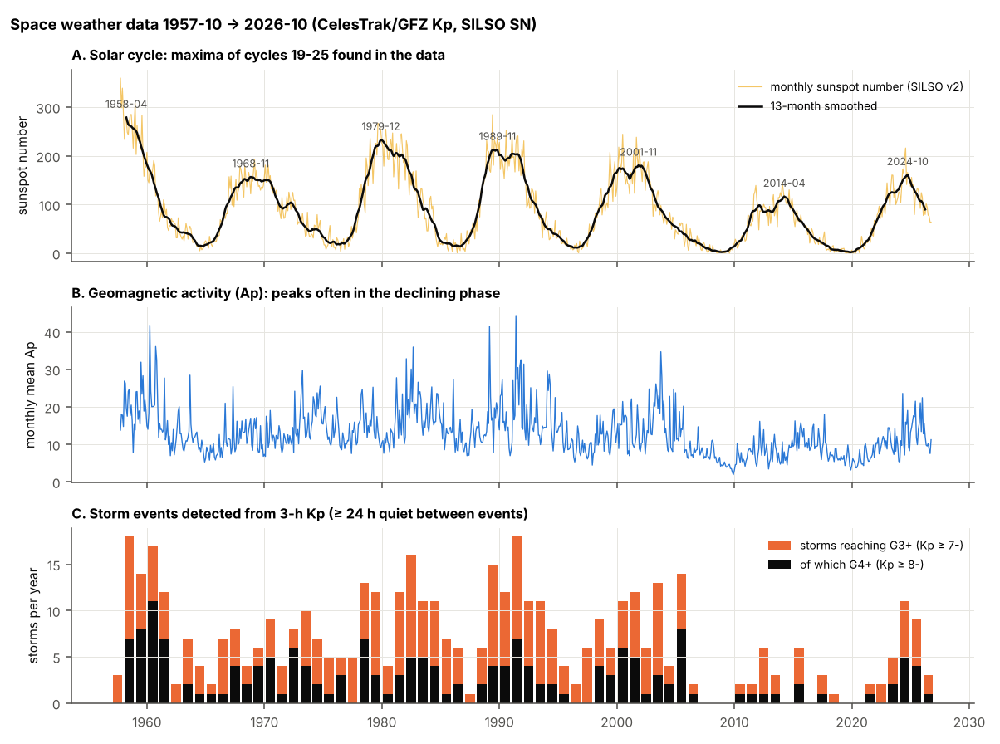
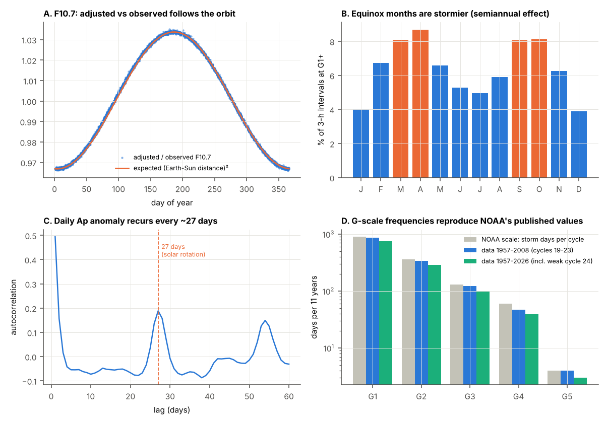
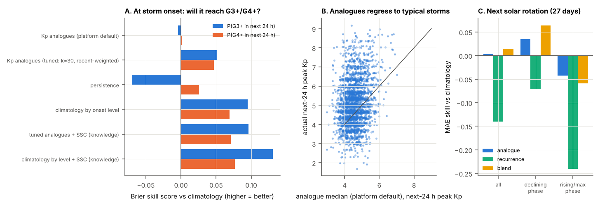
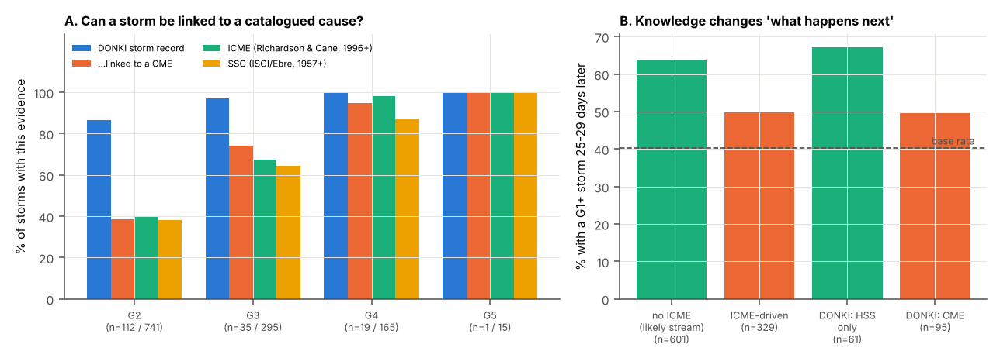
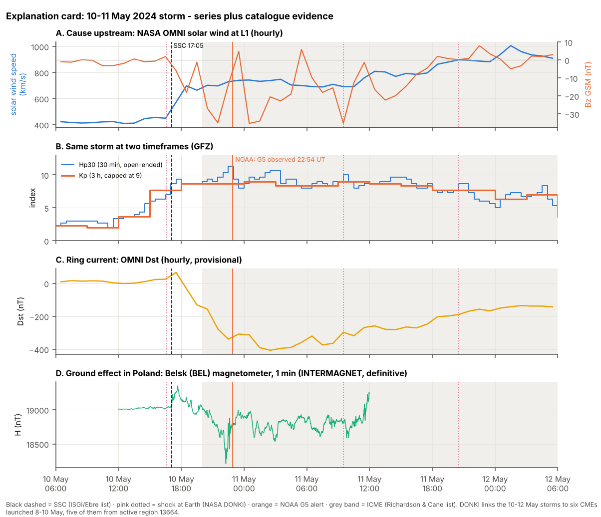

# Space weather as the platform's use case: sanity check, sources and decision

*Prepared 10 Oct 2026 for the SGH master's thesis. Data are checked up to 9 Oct 2026. Every number in this report is
produced by `scripts/sanity_and_feature_tests.py` and stored in `results/results.json`, unless a source is cited.*

Kp is reported in thirds: 5- = 4.67, 5o = 5.00, 5+ = 5.33. NOAA storm levels are G1 = Kp 5, G2 = 6, G3 = 7,
G4 = 8 (including 9-), G5 = 9o.

---

## Decision in short: **GO**

The business case is judged as the motivation of a master's thesis: how costly and how widespread the problem is, and
what it means for Poland. Competitors and market size are out of scope.

| Question | Answer | Why |
|---|---|---|
| Does space weather fit the platform idea (anomalies, hand-picked moments, multi-timeframe similarity, "what happened after", knowledge-grounded explanation)? | **Yes. It is the best technical fit of all candidates.** | There are 69 years of clean 3-hour data and natural timeframes from 1 minute to 11 years. Event catalogues are built from other observations (coronagraphs, solar-wind monitors, magnetometer networks). They give a cause for **every strong (G3+) storm since 2010**, against 32 % for randomly shifted windows. |
| Does the business case make sense for the thesis? | **Yes.** | The problem is **costly**: 38 of 49 new Starlink satellites were lost in one minor storm; Kansas State economists estimate US$53 M–1.29 B of lost US corn revenue in May 2024; Lloyd's extreme scenario reaches US$2.4 tn. It is **widespread**: GNSS/RTK users in farming and construction, satellite operators, power grids and aviation are all affected, and Poland's public RTK network ASG-EUPOS has about 48 k accounts. It **recurs**: G1+ conditions on about 74 days a year and about 7 strong (G3+) storms a year, with only 7 calendar years since 1958 without one. In Poland, grid failures rise after storms (Gil et al. 2021). Users ask for what the platform produces, a cited explanation of each incident (Green et al. 2017). |
| What did the tests change? | **"What happened after" needs causes and knowledge, not only similar Kp shapes.** | Retrieving similar Kp windows adds nothing beyond knowing the current storm level. Analogues score a Brier skill of −0.004 (default) to +0.05 (tuned), while a simple climatology by onset level scores +0.095. One catalogue fact, whether a shock (SSC) arrived between 24 h before onset and the end of the onset interval, raises the skill to +0.131 and the AUC from 0.68 to 0.74. |

**Recommendations for the thesis** (details in §9):
1. **Analogues.** Build them on driver features (solar wind, CME speed, shock flags), not on Kp alone. The benchmark to
   beat is "climatology by onset level + SSC" (Brier skill 0.131).
2. **Knowledge layer.** Build the cause chain from the catalogues (DONKI, Richardson & Cane, SSC, proton events), and
   retrieve from the public-domain NOAA SWPC text archive.
3. **Data hygiene.** Store each value's source and status (definitive or preliminary), and re-index after revisions.
4. **Business chapter.** Quantify cost and breadth with the numbers in §8. If time allows, add one Polish impact
   series, such as GNSS station data or GUGiK interference notices, to show attribution on local data.
5. **Licences.** Every source used here may be used in a thesis with the citations it asks for, including the
   non-commercial (CC BY-NC) ones.

---

## 1. The idea being tested

The platform finds interesting moments in a time series: anomalies, moments a user marks by hand, and similar moments
at several timeframes, together with what happened after them. It then explains each moment with expert knowledge
(catalogues, reports, papers) and citations. It must solve a problem someone pays for. The workflow is:

```
detect or mark a moment → find similar past moments (several timeframes) → what happened after them
→ link to catalogued causes and expert texts → cited explanation → impact for the customer → action
```

For space weather, the series are geomagnetic indices (Kp/ap/Ap, Hp30), sunspot number and F10.7 solar radio flux.
The causes are flares, coronal mass ejections (CMEs), shocks and high-speed solar-wind streams. The impacts fall on
GNSS positioning, satellites, power grids and HF radio.

## 2. Sanity check against every planned feature

| Planned feature | Test on real data | Result | Verdict |
|---|---|---|---|
| Data for all features | Integrity and physics checks, 1957-10-01 to 2026-10-09 (§3) | 201,688 3-hour Kp values with no gaps, and no Kp/ap inconsistencies in either source file. The data reproduce the solar-cycle maxima, the equinox effect, the 27-day recurrence and NOAA's G-scale frequencies. | ✅ strong |
| Anomaly detection | An unsupervised detector (no labels) checked against an independent list of storm sudden commencements (SSC) (§4.1) | 67.5 % of the top-200 detections have an SSC, against 8.0 % of shifted random windows (8.4×). For anomalies below storm level the figures are 20.7 % against 4.5 %. | ✅ works. Most "anomalies" are storms, so the new value lies in quiet-time and relative anomalies and in data-quality checks. |
| Hand-picked moments | Six named storms marked by hand, including Nov 2025 and Jan 2026 (§4.2) | Each storm gets analogues, outcome statistics and catalogue links. Full explanation cards were built for three of them. | ✅ |
| Similarity search and "what happened after" | Leak-free backtest on 2,574 storm onsets, 1963–2026; target = peak Kp in the next 24 h (§4.3) | Similar-window analogues add nothing beyond the current storm level. Their Brier skill is −0.004 (default) and +0.05 (tuned), against +0.095 for climatology by onset level and **+0.131 with the SSC flag (knowledge)**. Extremes are under-forecast: when the next 24 h reached G4+, the analogue median was Kp 4.9 against an actual 8.1. | ⚠️ useful as context, weak as a forecast; needs driver features |
| Multi-timeframe | Hp30 (30 min) vs Kp (3 h) on 7 storms; analogues at the 27-day rotation scale on 835 rotations (§4.4) | Hp30 shows G3 0.5–5.5 h earlier (median 2.5 h) and separates extremes that Kp cannot: both storms are Kp 9o, but Hp30 reaches 12.0 in 2003 and 11.3 in 2024. Rotation-scale analogues beat climatology only in the declining phase (+3.5 %; +6.4 % blended with recurrence). | ✅ natural timeframes; modest forecast value at long scales |
| Knowledge-grounded explanation | Every storm linked to NASA DONKI, the Richardson & Cane ICME list and the SSC list (§4.5) | **100 %** of G3+ storms in 2010–2026 have at least one catalogued cause (randomly shifted windows: 32 %), and 82 % are linked to a specific CME (speed, source region). Since 1996, 79 % of G3+ storms coincide with an ICME. Knowledge also changes outcomes: a storm recurs 25–29 days later after 64 % of stream-driven storms but after only 50 % of CME-driven ones. | ✅ the strongest feature |
| Business case (thesis) | Literature research on costs, breadth of affected users and the Polish context (§8) | Costly, widespread and recurring, with Polish evidence for GNSS users and the grid. | ✅ |

## 3. Data sanity checks

Sources: the CelesTrak file of GFZ Kp/ap/Ap, SILSO sunspot number and DRAO F10.7 (1957-10-01 to 2025-06-30),
continued with GFZ's own API (2025-07-01 to 2026-10-09). Together that is 25,211 days (69.0 years).

| Check | Result | What it means |
|---|---|---|
| Completeness | 0 missing days, 0 duplicates, 0 missing Kp/ap. One F10.7 value is missing (2026-05-09, GFZ code −1). | Ready for windowing at any timeframe. |
| Kp vs ap | Every Kp/ap pair in both source files (198,120 + 3,728) follows the standard Kp→ap table, and every daily Ap is the mean of its 8 ap values. | Internally consistent. |
| Preliminary vs definitive | In the 20 days where both sources cover the same dates, 74 of 160 Kp values differ, 73 of them by one third (39 higher and 35 lower in the preliminary data). SN differs on 19 of 20 days. GFZ marks 457 days definitive and 9 preliminary. | Recent data get revised. The platform must store each value's status and re-index after revisions. |
| NOAA Kp vs GFZ Kp | Of the 196 DONKI storms whose NOAA real-time Kp reached 6- or more, 26 stay below G2 in GFZ's definitive Kp (22 of them peak at 5+). | Different Kp products disagree at the thresholds. Store the source of every index. |
| F10.7 adjusted vs observed | The ratio equals the squared Earth–Sun distance, within 0.005 on 100 % of days (1st–99th percentile 0.967–1.034). | The adjustment is the documented 1-AU correction. |
| Sunspot number vs F10.7 | Correlation of monthly means: r = 0.977. | The two solar-activity proxies agree. |
| Solar cycle | 13-month-smoothed maxima at 1968-11 (156.6), 1979-12 (232.9), 1989-11 (212.5), 2001-11 (180.3), 2014-04 (116.4) and 2024-10 (160.9). Minima at 1964-10, 1976-03, 1986-09, 1996-05, 2008-12 and 2019-12. (The 1958 maximum is cut by the series start.) | These match the official cycle maxima and minima to the month. |
| Geomagnetic activity vs cycle | Annual Ap peaks 1.2–5.6 years after the sunspot maximum: 1960, 1974, 1982, 1991, 2003 and 2015 (2025 so far). | Storms peak in the declining phase, as the literature describes (Richardson 2018). |
| Semiannual effect | G1+ intervals: 8.1–8.7 % in Mar, Apr, Sep and Oct, against 3.9–5.3 % in Dec, Jan, Jun and Jul (equinox/solstice ratio 1.81). | This is the Russell–McPherron equinox effect. |
| 27-day recurrence | The autocorrelation of the daily Ap anomaly peaks at exactly 27 days (0.19). It is strongest in 2008, 2007, 1974, 1994 and 1976; the mean is 0.24 in declining-phase years against 0.11 in other years. | The 27-day solar rotation is a real timeframe for analogues. |
| G-scale frequencies vs NOAA | See below. In 1957–2008 the data reproduce NOAA's published "per cycle" numbers within 0–22 %. | The scale and the data agree, and NOAA's "events" are 3-hour intervals. |
| Largest days | Daily Ap 280 (1960-11-13), 271 (2024-05-11), 246 (1989-03-13), 241 (1960-04-01), 236 (1959-07-15), 204 (2003-10-29). | Known historic storms come first. |
| Saturation | Kp stops at 9o. Hp30 reached 12.0 (2003-10-29) and 11.3 (2024-05-10). | Use Hp30 to rank extremes. |

G-scale frequencies per 11 years (storm days, and 3-hour intervals in brackets):

| Level | NOAA published | Data 1957–2008 (cycles 19–23) | Data 1957–2026 (with weak cycle 24) |
|---|---|---|---|
| G1 | 900 days (1700) | 859 (1586) | 743 (1356) |
| G2 | 360 (600) | 338 (538) | 286 (453) |
| G3 | 130 (200) | 122 (196) | 100 (161) |
| G4 | 60 (100) | 47 (91) | 39 (75) |
| G5 | 4 (4) | 4 (4) | 3 (4) |




## 4. Feature tests

Storm events are defined from 3-hour Kp: G1+ intervals belong to the same event unless 24 h without G1 separate them.
This gives 2,869 events since 1957. By peak level there are 1,652 G1, 742 G2, 295 G3, 165 G4 and 15 G5 events.

### 4.1 Anomaly detection vs an independent catalogue

The detector compares log(ap+1) with the median of the previous 27 days, scaled by the interquartile range (z ≥ 3), so
"anomalous" means unusual for the current background. The ground truth is the list of storm sudden commencements
(SSC), a separate observatory product (ISGI list maintained by Observatori de l'Ebre). A detection is a hit if an SSC
falls between 24 h before its start and 3 h after its peak. The base rate uses the same windows shifted by a random
5–25 days.

| Detector | Detections | With an SSC | Random windows |
|---|---|---|---|
| Robust z, top 200 | 200 | **67.5 %** | 8.0 % |
| Robust z, all | 409 | 59.2 % | 7.7 % |
| Robust z, only those staying below G1 | 29 | 20.7 % | 4.5 % |
| Matrix-profile discords, daily Ap (top 50) | 50 | 74.0 % | 29.2 % |
| Kp threshold, all G1+ storms | 2,867 | 33.2 % | 9.8 % |
| Kp threshold, G3+ storms | 475 | 73.5 % | 13.8 % |

Of the robust-z detections, 92.9 % reach G1 and 48.9 % reach G3, and they catch 41 % of all G3+ storms. They miss storms
that arrive during already-active weeks, because those are not unusual against the background. **Takeaway:** detection
works, but for space weather "anomaly" mostly means "storm", which a threshold already defines. The detector adds value
in three places: storms during quiet times, data-quality problems (gaps, preliminary values, source disagreements), and
later "forecast misses" measured against archived NOAA forecasts.

### 4.2 Hand-picked moments

A user marks the first 3-hour interval at which a named storm reached the level shown. The platform answers "what
happened after?" with analogues whose whole 72-hour continuation lies before the marked moment.
(`results/hand_picked_moments_analogues.csv`)

| Moment marked | Kp then | Actual peak next 24 h | Actual G1+ hours next 72 h | Analogue median peak | Analogue P(G4+) | Analogue median G1+ hours |
|---|---|---|---|---|---|---|
| Halloween 2003, 29 Oct 06 UT | 9o | 9- | 63 | 7+ | 0.3 | 15 |
| St Patrick's Day 2015, 17 Mar 12 UT | 8- | 8- | 36 | 6o | 0.1 | 9 |
| Starlink loss, 3 Feb 2022 06 UT (G1) | 5o | 5+ | 9 | 4+ | 0.2 | 1.5 |
| Gannon, 10 May 2024 15 UT | 8- | 9o | 45 | 6o | 0.1 | 13.5 |
| 12 Nov 2025 00 UT | 9- | 9- | 27 | 6o | 0.1 | 15 |
| 19 Jan 2026 18 UT | 8+ | 9- | 39 | 6+ | 0.3 | 13.5 |

The mechanics work for any moment. The answers show the same bias as §4.3: big storms have few close analogues, so the
analogues regress to typical storms and underestimate both peak and duration. The Starlink row matters for the business
case. The storm that destroyed 38 of 49 new satellites peaked at only **Kp 5+ (G1)**, a level the official scales treat
as minor. Impact depends on the customer's exposure (very low orbit), not on storm size.

### 4.3 "What happened after": leak-free backtest

Setup: 2,574 G1 storm onsets from 1963-01 to 2026-08. At the end of the onset interval, predict the peak Kp in the next
24 h, and the probability of reaching G3+ (base rate 12.7 %) and G4+ (4.2 %). Analogues may only use windows whose
continuation ended before the onset. Windows are 48 h (16 bars); "level" mode is the same as the prototype
`MultiTimeframeIndex` search at the 3-hour timeframe.

| Method | MAE of peak (Kp) | CRPS 24 h | Brier skill G3+ | AUC G3+ | Brier skill G4+ |
|---|---|---|---|---|---|
| Climatology (all past onsets) | 0.946 | 0.677 | 0 | 0.48 | 0 |
| Persistence (current Kp) | 0.875 | 0.875 | −0.070 | 0.56 | 0.026 |
| Kp analogues, platform default (k=10, all windows) | 1.015 | 0.744 | −0.004 | 0.61 | 0.002 |
| Kp analogues, past onsets (k=10) | 0.960 | 0.702 | −0.007 | 0.61 | −0.027 |
| Kp analogues, tuned (k=30, recent bars weighted) | 0.918 | 0.656 | 0.051 | 0.65 | 0.047 |
| Climatology by onset level | 0.887 | 0.633 | 0.095 | 0.68 | 0.069 |
| **Tuned analogues + SSC flag (knowledge)** | 0.884 | 0.633 | 0.096 | 0.73 | 0.071 |
| **Climatology by level + SSC flag (knowledge)** | **0.864** | **0.612** | **0.131** | **0.74** | **0.077** |

For 1996–2026 the best model reaches a Brier skill of 0.171 and an AUC of 0.76. For the 109 onsets followed by G4+, the
analogues gave G4+ a mean probability of only 0.057 (climatology 0.053).

Caveats: the backtest uses definitive Kp, while real-time values are noisier (§3). The choice k = 30 and the weights
were tuned on the same onsets, without a hold-out set. The SSC flag counts a shock between 24 h before onset and the end
of the onset interval, which assumes a real-time shock detector, because the curated SSC list is published later.

**What this means for the platform:**
1. Retrieving similar Kp windows gives a plausible spread of outcomes, but no skill beyond the current storm level,
   which a simple climatology by onset level already captures (Brier skill 0.095). The course of a storm depends on
   the solar wind and the CME, which the Kp history does not contain.
2. One knowledge feature from a catalogue, whether a shock arrived, adds clear skill (+0.036 Brier skill, +0.06 AUC).
   This supports the platform's core idea that knowledge improves "what happened after".
3. Default settings should change: k ≈ 30, recent bars weighted more, and filters on knowledge attributes (driver type,
   shock, CME speed). Solar-wind inputs (OMNI, DSCOVR/SWFO-L1) should be added as an extra entity for analogues, as in
   the analogue-ensemble literature (Owens et al. 2017; Haines et al. 2021).



### 4.4 Multi-timeframe

**Finer than Kp: Hp30 (30 min) vs Kp (3 h).** The table shows when each index first showed G3, counting from the end of
the interval in which the threshold was crossed.

| Storm | Max Hp30 | Max Kp | G3 first known from Hp30 | from Kp | Lead (h) |
|---|---|---|---|---|---|
| Halloween 2003 | 12.000 | 9o | 2003-10-29 05:30 | 09:00 | 3.5 |
| St Patrick's Day 2015 | 8.667 | 8- | 2015-03-17 09:30 | 15:00 | 5.5 |
| Sep 2017 | 9.000 | 8+ | 2017-09-07 23:30 | 09-08 00:00 | 0.5 |
| Oct 2024 | 10.667 | 9- | 2024-10-10 15:30 | 18:00 | 2.5 |
| Gannon, May 2024 | 11.333 | 9o | 2024-05-10 17:00 | 18:00 | 1.0 |
| Nov 2025 | 9.333 | 9- | 2025-11-12 00:30 | 03:00 | 2.5 |
| Jan 2026 | 10.000 | 9- | 2026-01-19 19:30 | 21:00 | 1.5 |

**Coarser: the 27-day solar rotation.** The test forecasts the next 27 days of daily Ap from the current rotation (835
rotations since 1965). The score is the MAE of log(Ap+1), expressed as skill against a 365-day climatology. The phase
labels come from the smoothed cycle and so use hindsight.

| Method | All | Declining phase | Rising/maximum phase |
|---|---|---|---|
| Analogues (k=10) | +0.3 % | +3.5 % | −4.2 % |
| 27-day recurrence | −14.0 % | −7.1 % | −24.0 % |
| Blend of analogue and recurrence | +1.4 % | +6.4 % | −5.9 % |

The natural timeframes run 1 min (magnetometers) → 30 min (Hp30) → 3 h (Kp) → 1 day (Ap) → 27 days (rotation) →
11 years (cycle), and each has a physical meaning. Finer bars help detection and ranking of extremes. Coarser bars carry
the 27-day recurrence, but they give only modest skill for day-by-day forecasts. Recurrence shows most clearly at event
level (§4.5).

### 4.5 Knowledge-grounded explanations

**Can each storm be linked to a catalogued cause?**

| Storms by peak | 1957–2026: with SSC | 1996–2026: with ICME | 2010–2026: DONKI storm record | …linked to a CME | …linked to a stream (HSS) | DONKI shock at Earth | Any catalogued cause |
|---|---|---|---|---|---|---|---|
| G2 | 38 % of 741 | 40 % of 224 | 87 % of 112 | 38 % | 43 % | 66 % | 93 % |
| G3 | 64 % of 295 | 67 % of 86 | 97 % of 35 | 74 % | 37 % | 86 % | 100 % |
| G4 | 87 % of 165 | 98 % of 50 | 100 % of 19 | 95 % | 11 % | 100 % | 100 % |
| G5 | 100 % of 15 | 100 % of 3 | 100 % of 1 | 100 % | 0 % | 100 % | 100 % |
| **G3+** | **74 % of 475** | **79 % of 139** | **98 % of 55** | **82 %** | 27 % | 91 % | **100 %** |

The matching windows are:
* **DONKI storm record:** its start lies between 12 h before the storm onset and 12 h after its end.
* **SSC or DONKI shock:** between 24 h before onset and 3 h after the peak.
* **ICME:** the interval from the disturbance minus 3 h to the ICME end plus 6 h overlaps the interval from onset to the
  peak plus 3 h.

Shifted by a random 5–25 days, the same windows find "any cause" only 32 % of the time (22 % for a CME, stream or ICME
link), against 100 % for the real G3+ storms of 2010–2026.

The catalogue families are not fully independent. DONKI storm records are defined from NOAA Kp, and 140 of the 644
Richardson & Cane disturbance times are SSC times. The CME, shock and ICME links themselves come from coronagraphs,
solar-wind monitors and magnetometer networks, not from Kp.

**Does knowledge change "what happens next"?** The test checks whether a G1+ storm occurs 25–29 days after a storm's
peak. Any random 5-day window contains one 40.2 % of the time.

| Storm driver (catalogue) | Storms | Storm again 25–29 days later |
|---|---|---|
| No ICME (likely high-speed stream), 1996–2026 | 601 | **63.9 %** (69.1 % in the declining phase) |
| ICME-driven (Richardson & Cane) | 329 | 49.8 % |
| DONKI: linked to a high-speed stream only, 2010–2026 | 61 | **67.2 %** |
| DONKI: linked to a CME | 95 | 49.5 % |

Stream-driven storms recur with the Sun's rotation and CME storms mostly do not, as the physics says (Richardson 2018).
The explanation layer therefore also improves the outcome statistics.



**Explanation card: 10–11 May 2024 ("Gannon").** The card is assembled automatically from the files in `data/` and saved
as `results/explanation_card_gannon_2024.json`.

| Layer | Evidence |
|---|---|
| Sun (DONKI) | Five CMEs launched 8–9 May (776–1,330 km/s; four from active region 13664, one from 13667) are linked to the 10 May storm. A sixth (10 May, 1,018 km/s) is linked to the separate G2 storm of 12 May. X-class flares came with proton events on 10 May (X3.9, 208 pfu) and 11 May (X5.8, 116 pfu) (NOAA SEP list). |
| Solar wind (OMNI) | Speed up to 1,006 km/s; Bz down to −35.3 nT (00–01 UT, 11 May). |
| Arrival | DONKI shock at Earth at 16:36 UT. SSC at 17:05 UT (Ebre list). Richardson & Cane ICME from 20:00 on 10 May to 15:00 on 12 May, with V = 800 km/s. |
| Storm | Kp 9o; Hp30 11.33 (22:30–23:00 UT); NOAA reported G5 at 22:54 UT. Dst −406 nT (OMNI hourly, provisional; −412 nT in Hayakawa et al. 2025). Daily Ap 271 is the **2nd-highest day since 1957**. |
| Poland | Belsk magnetometer (INTERMAGNET, 1 min): H jumped +208 nT between 17:06 and 17:08 UT, ranged over 1,139 nT within 24 h, and changed by up to 248.5 nT in one minute (22:37 UT). |
| Attention | 341,117 views of the English Wikipedia article "Aurora" on 11 May. |



**Recent events.** The same code built cards for the Nov 2025 and Jan 2026 storms from the catalogues alone
(`results/explanation_cards_recent_storms.json`). No language model was involved. The point is that the catalogues
already cover events after a model's training data, so explanations can rest on them rather than on model memory:
* **19–20 Jan 2026:** a CME at 1,820 km/s (18 Jan 18:09 UT, active region 14341) with an X1.9 flare, a proton event of
  37,000 pfu (third-largest since 1976 in the NOAA list), a shock at 18:55, an SSC at 19:17, an ICME with Dst −236 nT
  (provisional), Kp 9- and daily Ap 144 (32nd since 1957).
* **11–12 Nov 2025:** CMEs from active region 14274 (up to 1,856 km/s, X5.1 flare), a proton event of 1,460 pfu,
  SSCs at 22:52 and 00:09, an ICME with Dst −217 nT (provisional), Kp 9- and daily Ap 137.

## 5. Data sources

"Commercial use" refers to a paid product. All sources may be used in the thesis with the citations they request.

| Source | What it gives | Coverage | Access | Commercial use | Role |
|---|---|---|---|---|---|
| **GFZ Potsdam Kp/ap/Ap, Hp30/Hp60** | Official Kp family; Hp30/Hp60 have no upper cap | Kp since 1932 (3 h); Hpo V3.0 since 1985 | kp.gfz.de, JSON API, no login | **Yes**, CC BY 4.0 (except the SILSO sunspot column in the combined files) | core series |
| **NOAA SWPC** | Real-time Kp, 3-day forecasts, alerts, F10.7, SWPC sunspot number | Real time, with archives | services.swpc.noaa.gov (site now spaceweather.gov) | **Yes**, public domain | core series, forecast baseline |
| **NASA OMNI** | Solar wind and IMF at L1 plus indices | Hourly since 1963; 1 min since 1981 | SPDF / CDAWeb HAPI | Yes in practice (NASA data; cite DOI 10.48322/1shr-ht18) | drivers |
| SILSO sunspot number V2 | Daily/monthly sunspot number | Daily since 1818 | sidc.be/SILSO | **No** (CC BY-NC 4.0); NOAA's own sunspot number is the substitute | series |
| F10.7 (NRC Canada, DRAO) | Observed/adjusted radio flux | Since 1947 | spaceweather.gc.ca | Unclear: no licence found; take it via GFZ or NOAA | series |
| Kyoto WDC Dst/AE/SYM-H | Ring-current and auroral indices | Dst since 1957 | wdc.kugi.kyoto-u.ac.jp | **No**; USGS Dst (public domain) is the substitute | series |
| ISGI aa | 3-hour index | Since 1868 | isgi.unistra.fr (e-mail form) | **No** (CC BY-NC) | long series |
| INTERMAGNET (Belsk, Hel) | 1-min observatory magnetometers | Belsk definitive data 1993–2025 | BGS HAPI, no login | **No** (CC BY-NC 4.0) without each institute's written permission | local ground effect |
| **NASA CCMC DONKI** | Linked flares, CMEs, shocks, storms, streams, proton events, with notes | Since 2010 | ccmc.gsfc.nasa.gov/DONKI-API (moved 30 Sep 2026; ranges ≤ 60 days) | Unclear: "as is", research quality; no explicit ban | ground truth, expert notes |
| SOHO/LASCO CDAW CME catalogue v2 | Hand-measured CMEs | 1996 to May 2026 | cdaw.gsfc.nasa.gov | Unclear | ground truth |
| Richardson & Cane ICME list | ICME arrivals with Dst and source CME | 1996 to Jul 2026 (revised 23 Jul 2026) | izw1.caltech.edu | Unclear (cite DOI 10.7910/DVN/C2MHTH) | ground truth |
| ISGI/Ebre SSC list | Storm sudden commencements | Since 1868 | isgi.unistra.fr; obsebre.es | **No** (CC BY-NC) | ground truth |
| NOAA solar proton event list | Proton events above 10 pfu with flare and CME | Since 1976 | ngdc.noaa.gov | Yes (NOAA) | ground truth |
| NOAA GOES flare report (new) | One row per flare: class, times, location, region | 1995 to Sep 2026 | data.ngdc.noaa.gov (CSV) | **Yes**, public domain | ground truth |
| HELIO4CAST ICMECAT v2.3 | 1,976 in-situ ICMEs from many spacecraft | 1990 to Aug 2025 | helioforecast.space/icmecat | Unclear (asks for contact) | ground truth |
| CCMC CME Scoreboard | Predicted vs observed CME arrivals and Kp | Active to 2026 | webtools.ccmc.gsfc.nasa.gov | Unclear | forecast-miss labels |
| **NCEI archive of SWPC text** | Daily report (since 1966), forecast discussions (since Mar 2024), 3-day forecasts with rationale (since Mar 2022), The Weekly (since 1997) | see left | ncei.noaa.gov | **Yes**, public domain | **time-stamped expert text** |
| STCE/SIDC (Belgium) | Daily URSIgram, weekly newsletter | Online since at least 2012 | stce.be, sidc.be | Unclear (treat as copyrighted) | expert text |
| EPN; IGS TEC/ROTI | European GNSS stations; global ionosphere maps | IGS since 1998 | epncb.oma.be; CDDIS (free Earthdata login) | **Yes** (EPN CC BY 4.0; IGS open incl. commercial) | **impact** |
| Nevada Geodetic Lab | GNSS station positions, 5 min and daily | Thousands of stations | geodesy.unr.edu | Unclear | impact |
| GUGiK / ASG-EUPOS | Polish RTK network: outage and interference notices, ionosphere charts | Real time; no bulk archive found | asgeupos.pl, geoportal.gov.pl | Unclear | impact (PL) |
| Surya benchmarks; MagNet | Heliophysics foundation-model datasets; Dst prediction challenge | 2010–2024; 2021 | Hugging Face; GitHub | Surya: Yes (Apache-2.0 / CC BY 4.0). MagNet: Dst is Kyoto data, so no | benchmarks |

## 6. Data in this folder

All files were read on 10 Oct 2026 in the browser and transferred with SHA-256 checks (`data/MANIFEST_D1.md`,
`data/MANIFEST_D2.md`).

| File | Rows | Coverage | Source and terms |
|---|---|---|---|
| `gfz_kp_ap_Ap_SN_F107_daily_2025-07-01_to_2026-10-09.csv` | 466 days | 2025-07 to 2026-10 | GFZ API, CC BY 4.0 (SN column: CC BY-NC) |
| `gfz_Hp30_selected_storms.csv` | 1,104 | Six storm windows, 2003–2026 | GFZ API, CC BY 4.0 |
| `donki_gst_2010-01-01_to_2026-10-09.csv` | 201 storms | 2010-04 to 2026-10 | NASA CCMC DONKI |
| `donki_cme_linked_to_gst.csv` | 148 CMEs | 2010–2026 | NASA CCMC DONKI |
| `donki_ips_earth_2010-01-01_to_2026-10-09.csv` | 683 shocks | 2010–2026 | NASA CCMC DONKI |
| `richardson_cane_icme_1996_to_2026.csv` | 644 ICMEs | 1996-05 to 2026-07 | Caltech list, DOI 10.7910/DVN/C2MHTH |
| `isgi_ssc_1957_to_2026.csv` | 1,806 SSC/SI | 1957-01 to 2026-08 (2023–2026 preliminary) | Observatori de l'Ebre for ISGI, CC BY-NC 4.0 |
| `noaa_sep_events_1976_to_2026.csv` | 320 | 1976-04 to 2026-07 | NOAA SWPC list (NGDC copy) |
| `omni_hourly_2024-05-08_to_2024-05-15_gannon.csv` | 192 h | May 2024 | NASA OMNI via CDAWeb HAPI |
| `intermagnet_BEL_1min_2024-05-10T12_to_2024-05-11T12.csv` | 1,440 min | 10–11 May 2024 | Belsk (IGF PAN), INTERMAGNET definitive data, CC BY-NC 4.0 |

The 69-year Kp series is `../samples/02_space_weather/`, plus the merged file `results/kp_ap_Ap_SN_F107_daily_1957-10-01_to_2026-10-09_merged.csv.gz`.

## 7. Expert knowledge for the explanation layer and the thesis

| Item | Type | Open | What it explains | DOI / URL |
|---|---|---|---|---|
| Temmer 2021, *Living Rev. Sol. Phys.* 18:4 | review | Yes | Solar drivers: CMEs, flares, particles, streams; CME travel times | 10.1007/s41116-021-00030-3 |
| Pulkkinen 2007, *LRSP* 4:1 | review | Yes | Magnetospheric response: ring current, substorms | 10.12942/lrsp-2007-1 |
| Richardson 2018, *LRSP* 15:1 | review | Yes | Stream interaction regions, 27-day recurrence, declining-phase storms | 10.1007/s41116-017-0011-z |
| Kilpua et al. 2017, *LRSP* 14:5 | review | Yes | CMEs and sheaths drive the most intense storms | 10.1007/s41116-017-0009-6 |
| Hathaway 2015, *LRSP* 12:4 | review | Yes | Solar cycle | 10.1007/lrsp-2015-4 |
| Lockwood et al. 2020, *JSWSC* 10:23 | paper | Yes | Equinox (Russell–McPherron) effect | 10.1051/swsc/2020023 |
| Eddy 2009, *The Sun, the Earth, and Near-Earth Space* | book (NASA) | Free PDF | Plain-language background | lwstrt.gsfc.nasa.gov (PDF) |
| Matzka et al. 2021; Yamazaki et al. 2022 | data papers | Yes | What Kp, ap, Ap and Hp30 mean | 10.1029/2020SW002641; 10.1029/2022GL098860 |
| Clette & Lefèvre 2016; Tapping 2013 | data papers | Partly | Sunspot number V2; F10.7 observed vs adjusted | 10.1007/s11207-016-1014-y; 10.1002/swe.20064 |
| Curto et al. 2007 | data paper | Yes | Storm sudden commencements vs sudden impulses | 10.1186/BF03352059 |
| NOAA Space Weather Scales | reference | Public domain | G/S/R levels and how often they occur | spaceweather.gov/noaa-scales-explanation |
| RAEng 2013; Hapgood et al. 2021 | reports | Yes | Worst-case impacts on grids, GNSS, satellites, aviation | raeng.org.uk; 10.1029/2020SW002593 |
| NOAA Service Assessment, Oct–Nov 2003 | report | Public domain | Halloween 2003 impacts | repository.library.noaa.gov/view/noaa/6995 |
| Hayakawa et al. 2025, *ApJ* 979:49 | paper | Yes | Chain of events in May 2024 | 10.3847/1538-4357/ad9335 |
| Gil et al. 2021, *JSWSC* 11:30 (CBK PAN) | paper | Yes | Failures in the Polish grid after storms; Belsk geoelectric field | 10.1051/swsc/2021013 |
| NOAA SWPC text archive at NCEI | text archive | Public domain | Dated forecaster narrative for every day since 1966 (machine-readable text from about 2003) | ngdc.noaa.gov/stp/space-weather/swpc-products/ |
| SIDC URSIgram, STCE newsletter | text archive | Free to read, licence unclear | European daily and weekly narrative | sidc.be; stce.be |
| Wikipedia "List of solar storms" | text | CC BY-SA | Seed list of named events (1582 to Jan 2026) | en.wikipedia.org/wiki/List_of_solar_storms |

**Best knowledge stack for the platform:**
1. Structured catalogues: DONKI, Richardson & Cane, SSC, SEP and the GOES flares. These produce the cause chain.
2. The public-domain NOAA SWPC text archive, as the time-aligned retrieval corpus.
3. The open reviews above, for background explanations.

That stack is open and dated, and most of it allows commercial use.

**Related work to position the thesis:**
* *Analogue forecasting:* "similar day" analogue ensembles (Owens et al. 2017, 10.1007/s11207-017-1090-7); analogues
  beat 27-day recurrence on 150 years of aa and had the highest economic value (Haines et al. 2021,
  10.1029/2020SW002624); a similarity-based 3-day Kp forecast (Wang et al. 2023, 10.3389/fspas.2023.1082737).
* *Machine learning:* Camporeale 2019 (10.1029/2018SW002061); probabilistic storm-onset prediction (Chakraborty &
  Morley 2020, 10.1051/swsc/2020037).
* *Language models and knowledge:* SolarGPT-QA (arXiv:2601.12131) answers space-weather questions without retrieving
  sources. Heliophysics knowledge graphs exist (HelioKG; Heliophysics Event Knowledgebase, 10.1007/s11207-010-9624-2).
  The NASA/IBM foundation model Surya (arXiv:2508.14112) works on solar images.
* *The gap the thesis fills:* one search found no matrix-profile or retrieval-augmented, citation-grounded analogue
  system on geomagnetic indices (worth re-checking).

## 8. Business case for the thesis

For the thesis, the business case has to show three things. The problem **costs money**. It **affects many users and
recurs**. The platform's outputs address it, in the **Polish context** too. Competition, market size and sales are out
of scope.

### 8.1 The problem

When a GNSS/RTK service degrades or a satellite misbehaves, the user has to answer quickly, and in a way they can
defend: *was this space weather, a local fault or jamming? How unusual was it? What usually happens next?* Official
services publish regional alerts, not explanations of individual incidents. Satellite operators ask for "simple,
accurate tools to determine whether an anomaly is space-weather related" (Green, Likar & Shprits 2017). In that study's
Atrium database about 20 % of more than 2,300 anomalies on 922 satellites were attributed to space weather. A single
anomaly review board costs about $1 M.

**What the platform contributes:** a cited incident explanation within an hour. It gives the storm level at the time,
the chain of catalogued causes, the rank of the event against 69 years of data, and what happened after similar past
storms (peak, duration, recurrence). Where the user's own data exist, it also gives the probability that space weather
caused the incident rather than jamming or a fault.

### 8.2 What the problem costs

| Event | Impact | Number | Source |
|---|---|---|---|
| Feb 2022, Starlink | 38 of 49 new satellites lost in a G1 storm (Kp 5+ in our data) | cost not disclosed | NOAA repository; Fang et al. 2022; Kataoka et al. 2022 |
| May 2024, agriculture | RTK degraded during planting | Kansas State economists: US$53 M–1.29 B corn revenue loss in 12 states, US$12–17 k per farm (conference abstract; the widely quoted "$500 M" was an early estimate) | CPAESS abstract, SWW 2025 |
| May 2024, satellites | About 5,000 Starlink satellites manoeuvred; collision avoidance degraded for about 3 days | density about 5× near 450 km | NOAA user survey 2024; National Academies slides |
| May 2024, GNSS | Precise-positioning errors up to 70 m in the central US | — | Younas et al. 2025 |
| May 2024, grids | All load served; geomagnetically induced current above 90 A in 5 of 6 NERC regions | highest since 2013 | NOAA SWW 2026 slides (Olson) |
| Nov 2025 | GPS errors above 10 m at US mid-latitudes | press report | ScienceAlert |
| Jan 2026 | First S4 radiation storm since 2003; NOAA alerted airlines, the FAA and NERC | 37,000 pfu (our SEP data) | SWPC news |
| Oct 2003 | ADEOS-II lost; 59 % of NASA science missions affected; flights rerouted | US$640 M satellite; US$10–100 k per rerouted flight | NOAA Service Assessment 2004 |
| Poland, grid | TAURON failures in the 48 h after storms: 9.17 vs 5.91 before (p = 0.034) | — | Gil et al. 2021 |
| Systemic | Lloyd's 2025 extreme scenario; US grid failure; UK; Europe | US$2.4 tn over 5 years; US$6.2–41.5 bn per day; £9 bn and a 5–25 % chance in 5 years; €15 bn per extreme event | Lloyd's 2025; Oughton et al. 2017; UK NAO 2026; ESA |

### 8.3 How widespread the problem is

| Affected group | How space weather hurts | Scale | Source |
|---|---|---|---|
| GNSS/RTK users: farming, construction, surveying | Position errors, lost RTK fix, stopped work | Poland: ASG-EUPOS has about 48 k accounts, 23,799 active in Q3 2025, and a record 5,532 users at once (27 Aug 2025). US, May 2024: precise-positioning errors up to 70 m; corn revenue loss estimated at US$12–17 k per farm. | GUGiK; Younas et al. 2025; K-State abstract |
| Satellite operators | Drag, early re-entry, orbit errors, weaker collision screening, anomalies | About 20 % of more than 2,300 anomalies on 922 satellites attributed to space weather. About 5,000 Starlink satellites manoeuvred in May 2024. | Green et al. 2017; NOAA user survey 2024 |
| Power grids | Induced currents heat transformers; failures follow storms by 1–3 days | Poland: TAURON failures 9.17 in the 48 h after storms vs 5.91 before. North America, May 2024: currents above 90 A in 5 of 6 regions. | Gil et al. 2021; Olson (NOAA SWW 2026) |
| Aviation | HF blackouts, GNSS degradation, radiation | 738 ICAO space-weather advisories in 2025 (444 GNSS, 295 HF). Reroutes cost US$10–100 k per flight (2003). | ICAO 2025 report; NOAA Service Assessment 2004 |
| Society as a whole | An extreme event with system-wide losses | UK: 5–25 % chance of a severe event in 5 years, about £9 bn. Europe: about €15 bn per extreme event. | UK NAO 2026; ESA |

**How often it happens** (data in this folder, 1957–2026):
* G1+ conditions occur on **73.9 days a year** on average, about one day in five.
* G3+ conditions occur on 10.1 days a year, in **6.9 storms a year**. G4+ storms occur 2.6 times a year.
* Only **7 calendar years** from 1958 to 2025 had no G3+ storm. The busiest year (1958) had 18.

The problem is not only about rare extremes. Moderate storms come every year, and the Starlink loss shows that even a
G1 storm can be costly for an exposed user.

### 8.4 Poland

* **GNSS users.** ASG-EUPOS (GUGiK) has been free since 2 Oct 2022 and is used mainly for precision farming. GUGiK
  publishes notices of GNSS interference (jamming), so Polish users face exactly the question "space weather or
  interference?".
* **Power grid.** Gil et al. 2021 (CBK PAN with Siedlce University) found more failures in TAURON's network after storms,
  using the Belsk geoelectric field.
* **Science partners.** CBK PAN is a member of PECASUS, the European aviation space-weather consortium, and has run
  ESA's Ionospheric Weather Expert Service Centre since 2015. IGF PAN runs the Belsk and Hel observatories. This folder
  contains Belsk 1-minute data of the May 2024 storm, in which H swung by 1,139 nT within 24 hours.
* **Public attention.** The Polish Wikipedia article "Zorza polarna" had 20,795 views on 11 May 2024, against a median
  of 195 a day in April 2024.
* **Policy relevance.** Poland pledged about €550 M to ESA optional programmes for 2026–28, including Space Safety.

### 8.5 Licences for the thesis

All sources in §5 may be used in a university thesis with the citations they request. That includes the
non-commercial (CC BY-NC) data from SILSO, ISGI/Ebre and INTERMAGNET. Kyoto WDC allows scientific use with
acknowledgement. Only SuperMAG forbids redistribution, and it is not used here. If the platform ever became a product,
the non-commercial sources would need permission or substitutes (the NOAA sunspot number, USGS Dst).

### 8.6 Limits to keep in mind

* **Rare extremes.** There have been only 15 G5 storms since 1957, so evaluate mainly on G3+ storms.
* **Cost data.** Costs per event are sparse and mostly from the US. Present them as ranges and cite them carefully;
  several come from conference abstracts or press reports.
* **Forecast skill.** Kp alone has little forecast skill. Add solar-wind and catalogue features (§4.3).
* **Preliminary data.** Recent values are preliminary. Store the status and re-index after revisions (§3).
* **Incident data.** Attribution needs incident data. Use public proxies for impact: GNSS station positions (EPN/NGL),
  GUGiK notices, or satellite orbit data.

### 8.7 How the thesis can show the value

| KPI | Target | How |
|---|---|---|
| Explanation coverage | ≥ 95 % of G3+ storms with a cited cause | §4.5 already gives 100 % for 2010–2026 (32 % by chance) |
| Explanation quality | ≥ 90 % of claims supported, ≤ 5 % invalid citations | Audit of ≥ 50 generated claims |
| "What happened after" skill | Better than climatology by onset level (Brier skill 0.095) and persistence; report CRPS | §4.3 protocol with driver features added; optionally compare with archived NOAA 3-day forecasts (since 2022) |
| Time to explanation | Report ≤ 1 h after a G3 crossing | Replay of 2024–2026 storms |
| Attribution (if an impact series is added) | AUC ≥ 0.8 | Labelled days: storms (catalogues), interference (GUGiK notices), quiet days |
| Expert feedback (optional) | Usefulness rating from 2–3 experts | For example CBK PAN, GUGiK/ASG-EUPOS |

## 9. Decision

### 9.1 Scorecard

The criteria and weights are the same as in the main dataset catalogue, where the business case counts double. For
the thesis, "business case" means the cost, breadth and Polish relevance of the problem. "Access" means openness for
research.

| Criterion | Weight | Score (1–5) | Evidence |
|---|---|---|---|
| Business case (cost and breadth of the problem) | 2 | **4** | Well-documented costs for single events and whole systems; many affected groups; recurs every year; Polish evidence for GNSS users and the grid. Costs per event are sparse and mostly from the US. |
| Data volume and quality | 1 | 5 | §3: 69 years, no gaps, physics reproduced |
| Ground-truth events | 1 | 5 | §4.5: three catalogue families plus the proton-event list; 100 % coverage of G3+ storms against 32 % by chance |
| Open expert knowledge | 1 | 5 | §7: open reviews plus a public-domain daily text archive since 1966 |
| Anomaly-detection fit | 1 | 4 | §4.1: 8× above chance, but an anomaly is mostly a storm |
| Similarity and "what happened after" | 1 | 3 | §4.3: similar Kp windows add no skill beyond the current level; knowledge does |
| Multi-timeframe fit | 1 | 4 | §4.4: physical timeframes from 1 min to 11 years |
| Access and licences (research) | 1 | 4 | Open and free for research. Small hurdles: an ISGI e-mail form, an Earthdata login for IGS, DONKI's 60-day request limit. |
| Polish relevance | 1 | 4 | ASG-EUPOS, the TAURON grid study, CBK PAN, Belsk and Hel |
| **Weighted total** | | **42 / 50 = 84 %** | Tier A |

**Decision rule** (unchanged):
* GO: at least 80 % overall, with a business-case score of 4 or more.
* Conditional GO: 65–80 % overall, or a business-case score of 3.
* NO-GO: below 65 %, or a business-case score of 2 or less.

**Result: GO.** Space weather fits the platform idea best of all candidates. The problem is costly, widespread and
relevant to Poland, which is what the thesis needs to show. An earlier version of this report gave a "conditional"
verdict because it judged commercial viability (competitors, market size, sales). That is out of scope for the thesis.

### 9.2 Next steps

1. **Data (weeks 1–2).** Use GFZ Kp/Hp30, NOAA SWPC (including the text archive at NCEI), NASA DONKI and OMNI, plus the
   catalogues in `data/`. Store each value's source and status.
2. **Analogue engine.** Set k ≈ 30 and weight recent bars more. Add solar-wind and CME-speed entities, and filters on
   knowledge attributes (driver type, shock). The benchmark is "climatology by level + SSC" (Brier skill 0.131).
3. **Knowledge layer.** Build the cause chain from the catalogues and add retrieval over the SWPC texts. Measure
   coverage and citation precision.
4. **Business chapter.** Use §8 for costs, breadth and Poland. Optionally, demonstrate attribution with one Polish
   impact series: EPN/IGS stations in Poland (for example BOGO, JOZE, WROC; check availability), with GUGiK
   interference notices as counter-examples.
5. **Evaluation.** Use the KPIs in §8.7.

### 9.3 What would weaken the case

* **The analogue engine with driver features still does not beat the onset-level climatology.** "What happened after"
  is then presented as context (a distribution of past outcomes), not as a forecast.
* **No Polish impact series shows a storm signal.** An example would be GNSS errors on G3+ days that are no higher than
  on quiet days. The business chapter then rests on the literature costs alone, which is acceptable but weaker.

## 10. Files in this folder

| Path | Content |
|---|---|
| `README.md` | This report |
| `data/` | Ten verified CSVs (§6) and two manifests with URLs, retrieval times, hashes and licence quotes |
| `scripts/sanity_and_feature_tests.py` | Reproduces every number and figure (`python space_weather_decision/scripts/sanity_and_feature_tests.py`, about 1 min) |
| `results/results.json` | All numbers quoted above |
| `results/*.csv` | Storm events with catalogue links, backtests, G-scale comparison, coverage, Hp30 vs Kp, hand-picked moments |
| `results/explanation_card_gannon_2024.json`, `results/explanation_cards_recent_storms.json` | Machine-made explanation cards |
| `figures/fig1–fig5` | Overview, sanity checks, backtests, knowledge links, Gannon explanation card |

## Sources

Data and catalogues
* GFZ Potsdam Kp/Hpo: https://kp.gfz.de/en/data · API https://kp.gfz.de/app/json/ · licence note https://kp.gfz.de/app/format/Kp_ap_Ap_SN_F107_format.txt · Hpo V3.0 from 1985 https://kp.gfz.de/en/hp30-hp60
* CelesTrak space-weather data (1957–2025 sample): https://celestrak.org/SpaceData/
* NASA CCMC DONKI: https://ccmc.gsfc.nasa.gov/tools/DONKI/ · API https://ccmc.gsfc.nasa.gov/DONKI/api/
* Richardson & Cane ICME list: https://izw1.caltech.edu/ACE/ASC/DATA/level3/icmetable2.htm
* ISGI SSC list: https://isgi.unistra.fr/events_sc.php · Observatori de l'Ebre: http://www.obsebre.es/en/variations/rapid
* NOAA solar proton events: https://www.ngdc.noaa.gov/stp/space-weather/interplanetary-data/solar-proton-events/SEP%20page%20code.html
* NASA OMNI via CDAWeb HAPI: https://cdaweb.gsfc.nasa.gov/hapi/info?id=OMNI2_H0_MRG1HR
* INTERMAGNET HAPI (BGS): https://imag-data.bgs.ac.uk/GIN_V1/hapi · conditions https://intermagnet.org/data_conditions.html
* NOAA GOES flare report: https://data.ngdc.noaa.gov/platforms/solar-space-observing-satellites/goes/multi/l2/data/xrsf-l2-flrpt_science/csv/
* CDAW CME catalogue: https://cdaw.gsfc.nasa.gov/CME_list/ · HELIO4CAST ICMECAT: https://helioforecast.space/icmecat · CME Scoreboard: https://webtools.ccmc.gsfc.nasa.gov/CMEscoreboard/
* NCEI archive of SWPC products: https://www.ncei.noaa.gov/products/space-weather/partners/swpc-products-and-data
* STCE newsletter: https://www.stce.be/newsletter · SIDC: https://www.sidc.be/products/meu
* EPN: https://epncb.oma.be · IGS ionosphere products: https://cddis.nasa.gov/archive/gnss/products/ionex/ · NGL: https://geodesy.unr.edu
* ASG-EUPOS statistics Q3 2025: https://www.geoportal.gov.pl/aktualnosci/statystyki-wykorzystania-systemu-asg-eupos-iii-kwartal-2025/ · GUGiK on GNSS interference: https://www.geoportal.gov.pl/aktualnosci/zaklocenia-systemow-gnss-na-terytorium-polski/

NOAA scales and event reports
* NOAA Space Weather Scales: https://www.spaceweather.gov/noaa-scales-explanation
* G5 conditions observed, 10 May 2024: https://www.spaceweather.gov/news/g5-conditions-observed
* S4 radiation storm, 19 Jan 2026: https://www.spaceweather.gov/news/s4-severe-solar-radiation-storm-progress-january-19th-2026
* NOAA Service Assessment, Oct–Nov 2003: https://www.weather.gov/media/publications/assessments/SWstorms_assessment.pdf

Knowledge and related work
* Temmer 2021 https://doi.org/10.1007/s41116-021-00030-3 · Pulkkinen 2007 https://doi.org/10.12942/lrsp-2007-1 · Richardson 2018 https://doi.org/10.1007/s41116-017-0011-z · Kilpua et al. 2017 https://doi.org/10.1007/s41116-017-0009-6 · Hathaway 2015 https://doi.org/10.1007/lrsp-2015-4 · Lockwood et al. 2020 https://doi.org/10.1051/swsc/2020023
* Eddy 2009 (NASA): https://lwstrt.gsfc.nasa.gov/images/pdf/john_eddy/SES_Book_Interactive.pdf
* Matzka et al. 2021 https://doi.org/10.1029/2020SW002641 · Yamazaki et al. 2022 https://doi.org/10.1029/2022GL098860 · Clette & Lefèvre 2016 https://doi.org/10.1007/s11207-016-1014-y · Tapping 2013 https://doi.org/10.1002/swe.20064 · Curto et al. 2007 https://doi.org/10.1186/BF03352059
* RAEng 2013: https://raeng.org.uk/publications/reports/space-weather-full-report · Hapgood et al. 2021 https://doi.org/10.1029/2020SW002593
* Hayakawa et al. 2025 https://doi.org/10.3847/1538-4357/ad9335 · Younas et al. 2025 https://doi.org/10.1029/2025JA033839 · Gil et al. 2021 https://doi.org/10.1051/swsc/2021013
* Owens et al. 2017 https://doi.org/10.1007/s11207-017-1090-7 · Haines et al. 2021 https://doi.org/10.1029/2020SW002624 · Wang et al. 2023 https://doi.org/10.3389/fspas.2023.1082737 · Camporeale 2019 https://doi.org/10.1029/2018SW002061 · Chakraborty & Morley 2020 https://doi.org/10.1051/swsc/2020037
* SolarGPT-QA https://arxiv.org/abs/2601.12131 · Surya https://arxiv.org/abs/2508.14112 · Heliophysics Event Knowledgebase https://doi.org/10.1007/s11207-010-9624-2
* Wikipedia, List of solar storms: https://en.wikipedia.org/wiki/List_of_solar_storms

Business case (costs, breadth, Poland)
* Green, Likar & Shprits 2017, satellite industry: https://repository.library.noaa.gov/view/noaa/59675/noaa_59675_DS1.pdf
* Starlink Feb 2022: https://repository.library.noaa.gov/view/noaa/53091 · Fang et al. 2022 https://doi.org/10.1029/2022SW003193 · Kataoka et al. 2022 https://doi.org/10.1051/swsc/2022034
* Gannon storm and corn revenue (K-State, SWW 2025 abstract): https://cpaess.ucar.edu/abstract-sww-2025/impact-gannon-storm-corn-economic-assessment-agricultural-production-and-revenue
* NOAA user-needs survey 2024: https://www.weather.gov/media/nws/Results-of-the-First-National-Survey-of-User-Needs-for-Space-Weather-2024.pdf
* Grid currents in May 2024 (Olson, NOAA SWW 2026): https://swpc-drupal.woc.noaa.gov/sites/default/files/documents/2026-06/olson-mark.pdf
* Nov 2025 GPS errors (press report): https://www.sciencealert.com/?p=216651
* Lloyd's 2025 scenario: https://www.lloyds.com/insights/media-centre/press-releases/extreme-space-weather-scenario · Oughton et al. 2017 https://doi.org/10.1002/2016SW001491
* UK NAO 2026: https://www.nao.org.uk/wp-content/uploads/2026/03/the-uks-resilience-to-severe-space-weather-summary.pdf · ESA on Europe's impact: https://www.esa.int/Safety_Security/Space_weather_and_its_hazards3
* ICAO space-weather report 2025: https://www.icao.int/sites/default/files/APAC/Meetings/2026/2026%20MET%20SG-30/4.%20Information%20Papers/IP04_AI5_AUS_CONSOLIDATED-SPACE-WEATHER-SERVICE-MGMT-REPORT-2025.pdf
* CBK PAN in PECASUS: https://aeronomie.be/en/annual-report/pecasus-pan-european-consortium-aviation-space-weather-user-services · ESA platform news: https://scienceinpoland.pl/en/news/news%2C103433%2Cesa-launches-new-version-european-space-weather-platform.html
* Poland at ESA CM25: https://www.gov.pl/web/rozwoj-technologia/polska-wzmacnia-swoje-zaangazowanie-w-europejska-polityke-kosmiczna
